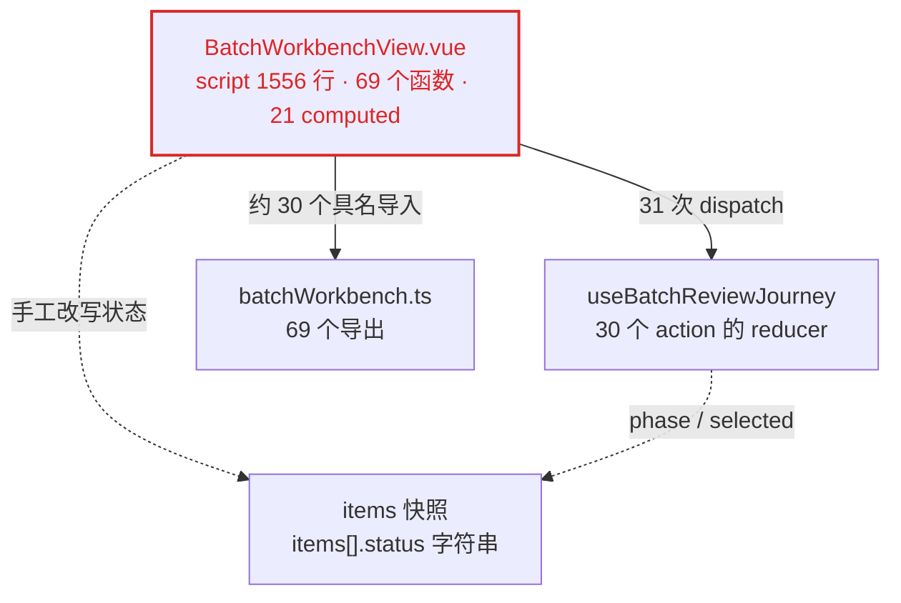
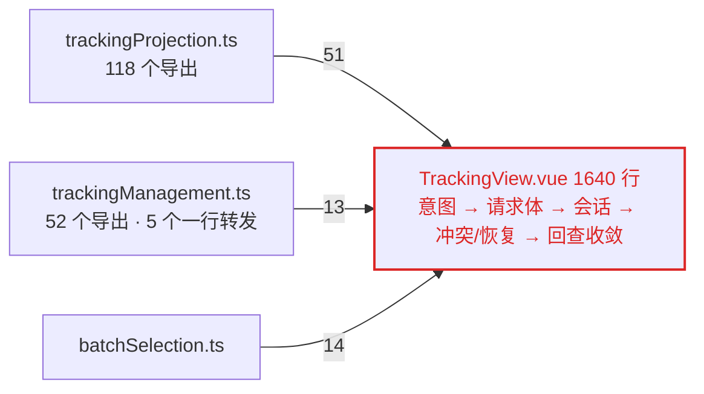
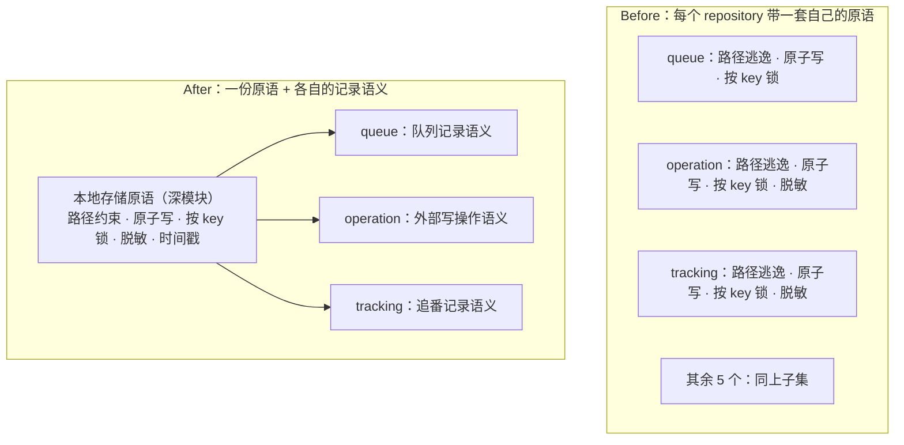
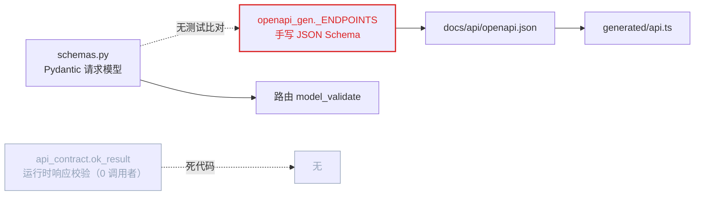
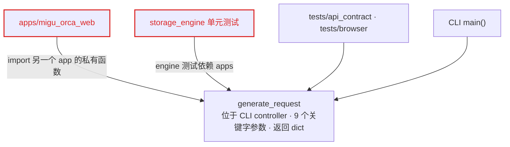

# 2026-10-02 代码库架构评审：深化机会

状态：一次性架构评审快照，反映已合入 `main` 的 `054de35`（PR #154；评审当时的提交为 `50420cc`，代码内容相同）的代码。
它提出候选方向，不决定实现方案，也不授予开发或发布权限。

本文件是 Agent 可读的主文档；同一评审的可视化版本在
[`assets/architecture-review-2026-10-02/report.html`](assets/architecture-review-2026-10-02/report.html)。

## 这份文档是什么 / 不是什么

- **是**：对当前实现中真实存在的结构摩擦的记录，每条带可核对的 `文件:行号` 证据，按近期改动热度排序。
- **不是**：规格、ticket、验收标准，或已批准的改造计划。候选之间没有依赖顺序，也没有承诺排期。
- **不是**：历史 Ralph Stage 的延续。新工作仍须按 Matt 工作流先 `grilling`、必要时 `domain-modeling`，
  再由 GitHub Issue 承载规格与验收。

## 词汇

用 `codebase-design` skill 的术语：**模块**、**接口**、**实现**、
**深度**、**深模块**、**浅模块**、**缝隙**（seam）、**适配器**、**杠杆**（leverage）、**局部性**（locality）。
领域词用 [CONTEXT.md](../../CONTEXT.md)：批量条目卡、批量合集候选卡、草案、追番方案、提交方式、
下载现有资源、持续追番、明确失败、结果待确认、预期总集数、已更新集数、已保存连接。已记录的不可逆决策见
[ADR-0001](../adr/0001-at-least-once-existing-resource-submission.md)。

## 候选概览

| # | 候选 | 强度 | 依赖类别 | 主要落点 |
| --- | --- | --- | --- | --- |
| 1 | 批量审核会话 | Strong | in-process | `frontend/src/features/workbench/` |
| 2 | 审核资格 | Strong | in-process | 前述 + `SingleAnimeReviewPanel.vue` |
| 3 | 集数证据投影 | Strong | in-process | 前述 + `tracking/` |
| 4 | 追番外部写会话 | Strong | in-process | `frontend/src/features/tracking/` |
| 5 | 本地存储原语 | Strong | local-substitutable | `src/storage_engine/controllers/` |
| 6 | 契约请求半端 | Worth exploring | ports & adapters | `src/apps/migu_orca_web/` |
| 7 | 方案生成缝隙 | Worth exploring | local-substitutable | `apps/migu_orca_entry` ↔ `apps/migu_orca_web` |
| 8 | AB 客户端装配 | Worth exploring | ports & adapters | `src/ab_engine/controllers/` |

---

## 1 · 把批量审核生命周期收进一个「批量审核会话」模块

**强度**：Strong ｜ **依赖类别**：in-process

**涉及文件**

- `frontend/src/features/workbench/BatchWorkbenchView.vue`（2910 行：script 1556 / template 500 / style 851）
- `frontend/src/app/composables/useBatchReviewJourney.ts`
- `frontend/src/features/workbench/batchWorkbench.ts`（814 行 / 69 个导出）
- `frontend/src/features/workbench/BatchWorkbenchView.test.ts`（2263 行）

**问题**：批量条目卡从名称输入到追番交接的生命周期由三个模块共同持有，SFC 还必须手工改写条目快照去镜像
状态机的 phase——同一次转换写两遍。

**方案**：让一个批量审核会话模块持有条目生命周期与派生状态；视图只订阅它并调用条目级命令，不再自己推算转换结果。

**收益**

- 局部性：同一次状态转换只写一遍
- 手写快照镜像消失
- 测试穿过会话接口，不再挂载 2910 行视图
- 删掉只写不读的状态

**证据**

- `BatchWorkbenchView.vue:155` 的 `parseBlocked` 同时读 5 个本地 ref；`:186-188` 的 `saveInFlight` / `savingItemIds`
  与状态机的 `saving` phase 并存。
- `:1235` 与 `:1311` 在 dispatch 之后又 `items.value = items.value.map(...)` 把快照改成 `RESPONSE_UNKNOWN`；
  `:1270-1303` 同样的双写覆盖 4 种失败形态。
- `:168 inputItemOrder` 只写一次、零读取；`:157 parseResult` 三写零读。
- 视图内 `:162-179` 用 computed 的 getter/setter 在本地 ref 与状态机之间来回代理。
- 测试侧：`BatchWorkbenchView.test.ts` 挂载整个 SFC 并 mock `@/api/client`，断言依赖 53 个 id 选择器与
  31 个 class 选择器，并在 `:231` 直接取 `wrapper.vm.parseBatch`。
- 历史：该文件 32 次提交、15 个 Issue（#56 → #159），其中 3 次是纯视觉/文案改动也落在同一文件。

**Before / After**



After：一个深模块「批量审核会话」吸收 parse → 候选 → 草案 → 保存 → 恢复全过程、条目 phase、selection 与
idempotency key，以及现在散在 `:1235`/`:1270-1303` 的手写镜像逻辑；对外只暴露「会话快照 + 条目级命令」，
视图剩下渲染与 DOM 接线。

---

## 2 · 把「审核资格」收成一个模块

**强度**：Strong ｜ **依赖类别**：in-process

**涉及文件**

- `frontend/src/features/workbench/BatchWorkbenchView.vue:289-313`
- `frontend/src/features/workbench/SingleAnimeReviewPanel.vue:123-140`
- `frontend/src/app/composables/useBatchReviewJourney.ts:206-208`

**问题**：单番与批量各写一份「可否确认」规则，同一批固定中文原因已经开始漂移，第三个判据又独立存在于状态机里。

**方案**：把资格判断做成一个模块，输入草案会话与编辑调度器状态，输出 confirmable 与阻断原因；批量条目卡、
批量详情、单番审核面板共用它。

**收益**

- 规则一份，口径不再分叉
- 文案只有一个源
- 资格判断可脱离视图单测
- 杠杆：一个接口，三个消费面

**证据**：三份判据的固定文案对照（同一规则，措辞已不同）

| 规则 | `itemConfirmability()` | `saveBlockers()` |
| --- | --- | --- |
| 草案重算中 | 正在重新计算**资源** | 正在重新计算**订阅方案** |
| 字幕组 | **请选择**有效字幕组 | **尚未选择**字幕组 |
| 编辑未应用 | 有尚未应用的编辑，正在等待过滤规则自动更新 | 同左 |
| 编辑未应用 | 有尚未应用的编辑，等待提交目录名 | 同左 |
| 编辑未应用 | 有尚未应用的编辑 | 同左 |
| 无有效资源 | 没有有效资源 | 同左 |

- `useBatchReviewJourney.ts:206-208 batchItemCanConfirm()` 只看 `phase`/`draftId`/`draftRevision`/`dirty`，
  与上面两份的判据不完全等价。
- `BatchWorkbenchView.vue:307` 还要同时检查本地 `savingItemIds`、条目 `status` 与状态机 phase 三处。

---

## 3 · 集数证据只留一份投影

**强度**：Strong ｜ **依赖类别**：in-process

> **2026-10-03 口径更新**：占位词已定为「未开发」，「未知」不再作为界面占位；由
> [#165](https://github.com/Ghostning233/migu_orca/issues/165) 承载，术语见 `CONTEXT.md` 的「界面占位表述」。
> 下方代码引文与「未知」字样是评审当时（`054de35`）的记录。

**涉及文件**

- `frontend/src/features/workbench/candidateSearch.ts:87-90`
- `frontend/src/features/workbench/batchWorkbench.ts:355`、`:453-457`
- `frontend/src/features/workbench/CandidateCard.vue:115`、`AnimeDraftEditor.vue:505`
- `frontend/src/features/tracking/TrackingInspector.vue:579`

**问题**：`CONTEXT.md` 定义的「预期总集数」规则（缺少可信数值即不可得，不从资源标题、种子数量或有效资源数推算）
有两份逐字实现，其中一处调用时传 `undefined` 让规则永不生效；另有四个渲染点各自处理缺值。

**方案**：让一个集数证据投影模块从候选/草案/详情的证据字段推出显示值，所有面消费同一个接口。

**收益**

- 规则一份，恒为「未开发」的调用消失
- 测试直接打投影接口
- 单番与批量口径一致
- 杠杆：一处规则，四个消费面

**证据**

```
candidateSearch.ts:87      Number.isInteger(total) && total > 0 ? `总集数：${total} 集` : '总集数：未知'
batchWorkbench.ts:453      Number.isInteger(total) && total > 0 ? `总集数：${total} 集` : '总集数：未知'
batchWorkbench.ts:355      batchEpisodeProgressText(undefined).replace('总集数：', '')   // 规则恒不生效
```

`batchWorkbench.ts:355` 消费方拿到的是「总集数」标签 + 恒为「未开发」的值；`ResourceSummary.vue` 与
`TrackingInspector.vue:579` 另有各自的缺值分支。

---

## 4 · 把追番外部写会话收成一个模块

**强度**：Strong ｜ **依赖类别**：in-process

**涉及文件**

- `frontend/src/features/tracking/trackingProjection.ts`（1292 行 / 118 个导出）
- `frontend/src/features/tracking/trackingManagement.ts`（772 行 / 52 个导出）
- `frontend/src/features/tracking/batchSelection.ts`
- `frontend/src/features/tracking/TrackingView.vue`（1640 行）、`TrackingInspector.vue`（1020 行）

**问题**：一个概念（外部写的意图、幂等键、冲突与结果）散在三个纯规则模块里，页面顶部要具名导入 78 个符号
才能拼出编排，且存在两套并行的会话状态机。

**方案**：让一个追番外部写会话模块拥有从意图到收敛的全过程——提交方式（下载现有资源 / 持续追番）、
幂等键与 expected revision、明确失败与结果待确认的区分、写后回查——导出一个窄接口；页面只渲染快照并发出意图。

**收益**

- 78 个具名导入收成少量
- 两套会话状态机合一
- 幂等与绑定只在一处演进
- 测试打会话接口，不挂载页面

**证据**

- `TrackingView.vue:20-106` 三个具名导入块分别导入 51 / 13 / 14 个符号，共 78 个。
- `trackingProjection.ts:657` 与 `:1112` 定义了两套平行会话：`TrackingWriteSession` 与
  `TrackingManagementSession`。
- `trackingManagement.ts:603-653` 五个构造器各只有一行，只是给 `createManagementSession` 固定一个 state 参数
  （浅模块：接口与实现等宽）。
- 测试重心错位：`trackingProjection.test.ts` 718 行 + `trackingManagement.test.ts` 717 行覆盖纯函数，
  而真正编排所在的 `TrackingView.test.ts` 只有 10KB。

**Before / After**



After：一个「追番外部写会话」深模块吸收意图、幂等键、提交方式、失败分类、冲突与恢复、写后收敛；
两个页面只读会话快照。

---

## 5 · 本地存储原语收敛成一份

**强度**：Strong ｜ **依赖类别**：local-substitutable

**涉及文件**

- `src/storage_engine/controllers/` 下 8 个 `*_repository.py`（queue / operation / tracking / ab_result /
  correction / request / idempotency / preference）
- `src/tracking_engine/models/tracking.py:313-319`、`:391`；`operation.py:52-55`、`:255`

**问题**：八个 repository 各自复制同一组存储原语，其中路径逃逸判定是安全策略；一处收紧要同步八处，
漏一处就是一个逃逸点。

**方案**：抽出本地存储原语模块（路径约束、原子写、按 key 锁、脱敏判定、时间戳），repository 只保留各自的
记录语义。

**收益**

- 删 8 份重复实现
- 安全策略一处生效
- 原语可独立测试
- 局部性：修复一次，处处修复

**证据**

| 原语 | 重复位置 |
| --- | --- |
| `_is_relative_to`（8 份逐字相同） | `queue:152`、`operation:568`、`tracking:444`、`ab_result:199`、`correction:354`、`request:261`、`idempotency:248`、`preference:564` |
| 原子写 | `tracking_repository.py:335-360` vs `operation_repository.py:408-435` |
| 按 key 锁 | `tracking_repository.py:410-423` vs `operation_repository.py:532-545` |
| `temp + os.replace` | 共 5 处 |
| 脱敏正则 | `tracking.py:313-319` vs `preference_repository.py:58-71` |
| 时间戳 | `tracking.py:391` vs `operation.py:255` |
| 版本字段 | `preference_repository.py:27`、`correction_repository.py:19`、`tracking.py:44`、`operation.py:52-55` |

**Before / After**



---

## 6 · 契约的请求半端只剩一个源

**强度**：Worth exploring ｜ **依赖类别**：ports & adapters

**涉及文件**

- `src/apps/migu_orca_web/schemas.py`（1048 行）
- `src/apps/migu_orca_web/openapi_gen.py`（`:423` 起 1443 行手写注册表）
- `docs/api/openapi.json`（27,993 行）、`frontend/src/api/generated/api.ts`（13,495 行）
- `src/apps/migu_orca_web/api_contract.py:1253`（`ok_result`）

**问题**：请求体有两个手写源——Pydantic 模型与注册表里手写的 JSON Schema，没有任何测试比对二者；
同时运行时的响应白名单校验入口零调用者。

**方案**：让注册表的请求体从 `schemas.py` 派生，并把响应白名单校验接回运行时（或删掉这个死入口）。

**收益**

- 一处改动到达四个产物
- 文档不再可能与校验器分叉
- 响应白名单运行时生效
- 删掉零调用者的死代码

**证据**

- 同一接口两份定义：`schemas.py:395-414 SavedTrackingSubmitInput`（8 字段、`extra=forbid`）与
  `openapi_gen.py:1054-1083`（同 8 字段、同 enum、同 default）。
- 既有测试只比对端点覆盖与漂移：`test_openapi_generation.py:44/65/123`，没有比对请求体形状。
- `api_contract.ok_result(result, dto)` 在全仓库无任何调用者（`grep -rn ok_result` 仅命中定义处），
  响应 DTO 白名单目前只在测试中生效。

**Before / After**



After：`schemas.py` 成为请求体的唯一源，`openapi_gen` 从它派生；运行时校验入口被接回路由或删除。

**与既有约束的关系**：不推翻根 `AGENTS.md` 的「契约同步」规则，也不动 inventory / OpenAPI / 生成客户端之间
的既有校验；只是把「源」从两处收回一处。

---

## 7 · 给「造一个真实方案」一个自己的缝隙

**强度**：Worth exploring ｜ **依赖类别**：local-substitutable

**涉及文件**

- `src/apps/migu_orca_entry/controllers/entry_controller.py:54 generate_request`（9 个关键字参数，返回 `dict[str, Any]`）
- `src/apps/migu_orca_web/services.py:18`（import 私有 `_build_history_event`）、`routes_requests.py:16`
- `src/storage_engine/controllers/storage_config_test.py:7`、`request_repository_test.py:7`
- `tests/api_contract/` 与 `tests/browser/` 的多个夹具模块

**问题**：造一个方案的唯一入口是 CLI 控制器函数：9 个关键字参数、CLI 语义的 `source_mode`、返回无类型 dict；
Web app 反向 import 另一个 app 的私有函数，engine 单测 import apps 造成层次倒置。

**方案**：把方案生成编排下沉到 engine 层的深模块；CLI 与 Web 退化为薄适配器，测试通过同一接口的
静态数据源适配器造夹具。

**收益**

- Web 不再 import CLI 私有函数
- engine 测试不再依赖 apps
- 9 个参数收窄成清晰入口
- 夹具与生产走同一接口

**证据**

- `generate_request` 被 28 个文件、75 处调用，包括 `tests/browser/` 的夹具与
  `src/storage_engine/controllers/*_test.py`。
- `apps/migu_orca_web/services.py:18-22` 从 `apps.migu_orca_entry.controllers.entry_controller` 同时导入
  `apply_confirmation_action`、`apply_request_save_action` 与私有 `_build_history_event`。
- `tests/browser/conftest.py:246` 一类调用依赖其默认静态数据源行为，但没有独立的夹具缝隙。

**Before / After**



After：编排下沉到 engine 层深模块，CLI adapter / Web adapter / 测试夹具 adapter 三者都只经过它的接口。

---

## 8 · AB 管理客户端：缝隙是真的，构造没被封住

**强度**：Worth exploring ｜ **依赖类别**：ports & adapters

**涉及文件**

- `src/ab_engine/controllers/ab_client.py:11`（`AutoBangumiClient` Protocol）
- `src/ab_engine/controllers/ab_management_client.py:10`（import 传输层私有 `_api_endpoint`）
- 6 处具体传输构造：`tracking_submission_service.py:188`、`tracking_recovery_service.py:185`、
  `tracking_saved_management_service.py:50`、`tracking_saved_recovery_service.py:77`、
  `tracking_saved_sync_service.py:31`、`tracking_sync_service.py:99`

**问题**：生产与测试两个适配器证明缝隙是真的，但每个调用方都要自己构造具体传输，管理客户端还 import
传输层的私有函数；同一 AB 提交在三处装配。

**方案**：由 AB 模块提供「按已保存连接引用解析管理客户端」的唯一入口，传输选择与重试留在实现内，
调用方只拿接口。

**收益**

- 6 处 `new` 收成一处
- 私有函数不再跨模块
- 三处装配合一
- 测试替换一个入口，而不是打 6 个补丁

**证据**

- `ab_client.py:11` 的 Protocol 与 `FakeAutoBangumiClient` 构成两个适配器，缝隙不是假设性的。
- 6 个 Web service 各自 `create_legacy_31_management_client(..., transport=UrlopenAutoBangumiHttpTransport())`。
- 同一 AB 提交在 `entry_controller.py:288-298`、`ab_engine/controllers/tracking_submit_adapter.py:10-22`、
  `tracking_submission_service.py:45-47` 三处装配。

---

## 也发现，但没有单列成卡

- **过滤规则匹配器两份实现**：`rss_engine/controllers/rss_controller.py:183-232` 与
  `request_engine/controllers/request_controller.py:424-497` 是同一套「包含/排除 + 正则 + 大小写」算法，
  只差错误码与字段名。删除任一份都会把复杂度集中到一处。
- **`src/shared/` 里的假设性缝隙**：`logging.py` 仅 `entry_controller.py:35` 使用；`management_contract.py`
  的 docstring 自称被下层共享，实际只有 Web 与 extensions 引用。真跨 engine 的只有 `errors.py`、`models.py`、
  `title_season.py`。
- **一次保存确认跨 7 个模块、约 11 跳**：`routes_requests.py:408` → `drafts.py:359` →
  `save_confirm_service.py:176` → `services.py:693/722` → `entry_controller.py:205/330` → `tracking_handoff.py:69`；
  `save_confirm_service` 入度为 6，是事实枢纽。

## 建议先做

**候选 1（批量审核会话）**。理由：`BatchWorkbenchView.vue` 是全仓最热点（32 次提交、15 个 Issue，测试与之
1:1 增长到 2263 行）；同时它是候选 2 与候选 3 的宿主——会话模块成形后，这两者是从它的接口上摘出来的模块，
而不是三次独立迁移。

---

## 供下游 Agent 的交接边界

把本文件交给下游 Agent 前，必须连同本节一起给；只给报告正文会让它把「候选」当「已批准的重构」。

**可以做的**

- 对选定候选执行 `grilling`：压清约束、依赖、缝隙位置、幕后实现、哪些测试能存活。
- 用 `domain-modeling` 固化新术语或补 ADR（例如「批量审核会话」「审核资格」是否进入 `CONTEXT.md`）。
- 产出 GitHub Issue：规格、纵向 ticket、依赖、验收标准，并先确认 `ready-for-agent`。

**不能做的**

- 不在 `grilling` 与 Issue 规格完成前写实现代码；本文件没有批准任何重构。
- 不改变根 `AGENTS.md` 与 `apps/migu_orca_web/AGENTS.md` 的不可破坏边界：真实 MiKan 合集仍须用户最终选择、
  草案权威在服务端、方案确认与外部提交是两次不同确认、未知结果不等于确定失败、外部删除固定 `file=false`、
  缺少可信数值时总集数与已更新集数显示「未开发」。
- 不重新争论 [ADR-0001](../adr/0001-at-least-once-existing-resource-submission.md)（下载现有资源的
  至少一次语义）。候选 4 只整理会话模块的位置，不改变该语义。
- 不把候选 6 当成「放松契约校验」的理由；它的方向是收窄源，不是取消校验。
- 不扩大范围到后续 Stage、移动端，或未被本文件列为候选的区域。

**验证口径**

- 前端候选：受影响 Vitest 用例 + `npm run typecheck` + `npm run lint`；UI 行为变更按项目
  `.agents/skills/dev-browser/SKILL.md` 在真实 Chromium 做定向验证。
- 后端候选：受影响 pytest 用例 + Ruff；契约变更额外执行 `uv run migu-orca-openapi`、
  `uv run migu-orca-openapi --check` 与前端 `npm run api:check`。
- 涉及本文件的数字时，以 `git rev-parse HEAD` 与对应文件行号重新核对为准；本快照不随代码演进自动更新。
