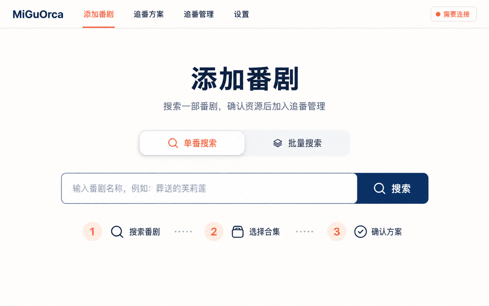
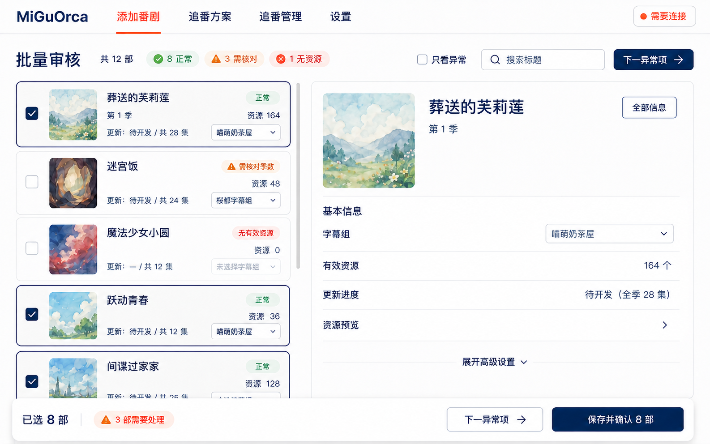
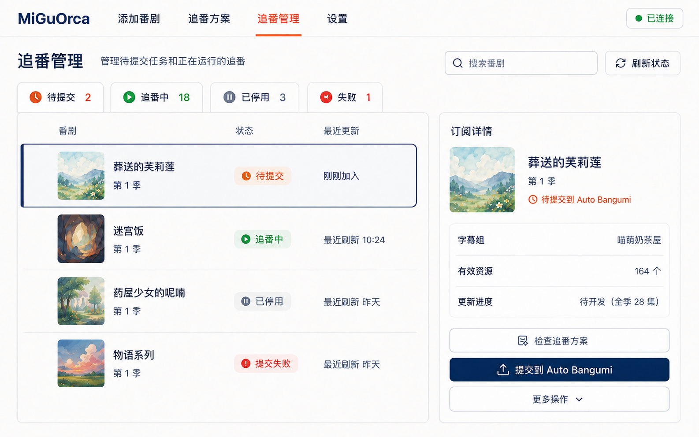
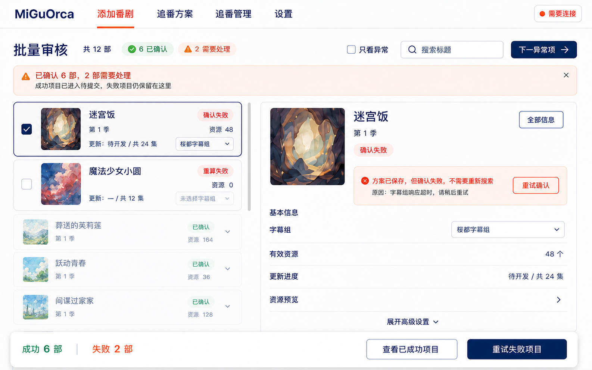
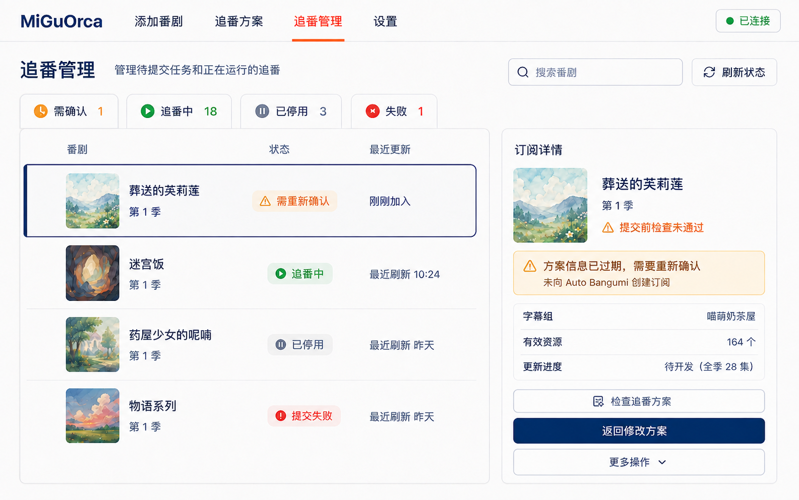

# MiGuOrca 前端视觉方向 V1

## 1. 状态

| 项目 | 内容 |
| --- | --- |
| 文档类型 | Gate 3 视觉方向与关键状态参考 |
| 当前状态 | 已通过评审并冻结；不是逐像素实现稿 |
| 生成日期 | 2026-09-07 |
| 生成方式 | Codex 内置 imagegen，`ui-mockup` 用例 |
| 依据 | 已冻结的混合低保真骨架与组件级交互规格 |

本组效果图用于确认视觉气质、信息层级、内容密度、主要区域比例和关键异常反馈。业务行为、
字段边界与状态规则以[交互规格](frontend-ux-interaction-spec.md)为准；颜色、字号、间距、圆角、
焦点与组件状态以[设计 Token V1](frontend-ux-design-tokens-v1.md)为准。图片中的生成细节不得
越过上述文字规格成为新的业务需求。

## 2. 视觉方向

- 气质：清爽、平静、面向普通番剧用户的桌面消费产品，不做成开发者后台或游戏 HUD。
- 基础色：暖白背景、深海蓝主色、少量珊瑚橙强调；成功、警告、失败使用克制的绿/琥珀/红。
- 字体：现代中文无衬线，标题清楚，正文不依赖微小字号。
- 表面：扁平为主，轻边框、适度圆角和非常轻的阴影；不使用玻璃拟态或霓虹渐变。
- 导航：顶部横向导航；当前页面同时使用颜色和下划线/形状，不只靠颜色。
- 内容：单番首页留白充分；批量审核和追番管理提高信息密度，但继续保留清楚分组。
- 封面：效果图使用无版权的抽象风景占位，正式产品仍展示经过安全代理的真实 MiKan 封面。

## 3. 单番首页



观察：

- 单一搜索任务非常突出，三步预告容易理解。
- 单番/批量分段控件的选中态明确，顶部四项导航没有挤压内容。
- “需要连接”保持轻量，没有阻止用户开始搜索。
- 实现时需把分段控件、输入框和按钮尺寸转为响应式 token，不能直接照图片写固定像素。

## 4. 典型 12 部批量审核



观察：

- 左侧约 36%、右侧约 64% 的比例能够同时容纳卡片字段和完整详情。
- 正常/需核对/无资源的状态层级清楚，底部固定操作栏能够持续说明本次影响范围。
- 字幕组在卡片和详情同时出现，直观表达了共享状态；实际实现必须由同一 draft store 驱动。
- “全部信息”已经修正为独立按钮；点击后打开只读安全信息弹窗，不与详情编辑页签混用。
- 图片只展示了部分卡片；36 部场景仍按交互规格使用连续滚动、筛选和下一异常，不分页。

## 5. 追番管理



观察：

- 状态总览、列表和右侧检查器的关系清楚，“待提交”与“追番中”没有混为一谈。
- 新条目被高亮后，“提交到 Auto Bangumi”是右侧唯一强主操作，符合显式外部提交边界。
- 运行状态颜色克制，危险操作没有放在表格行内。
- 列表已经修正为整行单选态和左侧指示条，不提供复选框或批量删除。
- 图片中的文字和封面仅为视觉参考，不能当作真实数据 fixture。

## 6. 关键异常状态

### 6.1 批量部分成功



- 成功与失败数量同时保留，不能用单一“成功/失败”消息覆盖整批结果。
- 成功条目进入“待提交”；失败条目原位保留、解释原因并允许局部重试。
- 固定操作区只对仍需处理的条目提供下一步，不能再次提交已经成功的条目。

### 6.2 提交前复核失败



- 页面明确说明尚未创建 Auto Bangumi 外部订阅，避免用户误以为已经生效。
- 失败原因位于当前条目和检查器附近，并提供“返回修改方案”的唯一恢复主操作。
- 修复后回到同一待提交条目继续，不要求重新搜索或手工复制 ID。

## 7. 生成提示词摘要

本组图片共享以下结构化提示：

```text
Use case: ui-mockup
Asset type: high-fidelity desktop web app visual reference, 1440 × 900 landscape
Style: realistic shippable consumer media UI, not concept art or enterprise dashboard
Palette: warm off-white, deep ocean navy, restrained coral-orange, accessible status colors
Structure: frozen top navigation and mixed guided/workbench layout
Typography: readable modern Chinese sans serif, no tiny paragraphs
Constraints: desktop only; no technical IDs, credentials, code, third-party logos, copyrighted anime art,
             browser chrome or watermark
```

各页面分别补充：

1. 单番首页：突出单番搜索、滑动分段控件和三步预告。
2. 批量审核 V2：保持原方向，只把“全部信息”修正为独立弹窗按钮。
3. 追番管理 V2：保持原方向，移除列表复选框并改为单选行指示。
4. 批量部分成功：同时表达成功去向、失败留置、原因与局部重试。
5. 提交前复核失败：表达服务端拦截外部写入、未创建订阅和返回修改方案。

## 8. Gate 3 结论

状态：**已完成（2026-09-07）**。

1. 采用“暖白 + 深海蓝 + 珊瑚橙”的整体视觉方向。
2. 采用首页留白较多、批量与管理页逐步提高密度的信息层级。
3. 采用轻边框、适度圆角、弱阴影的组件表面风格。
4. 两处已知生成偏差已经在 V2 参考图中修正。
5. 关键异常状态和可编码的设计 Token 已补齐。

原始 V1 图片继续作为设计过程记录保留，不再作为对应页面的实现参考。Gate 3 通过只授权进入
正式 PRD 与实现切片设计，不等于已经授权生产代码实现。
